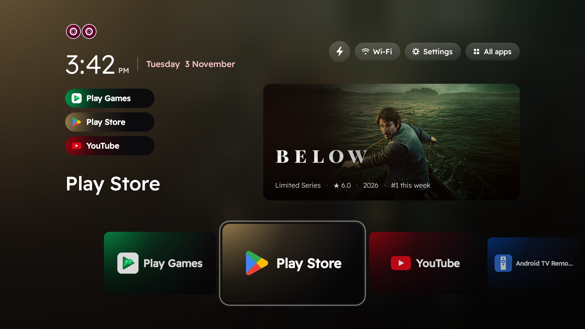
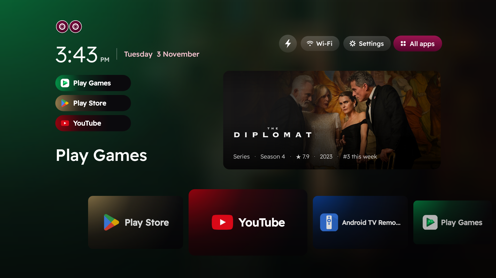

<div align="center">

# AK Home

**Full speed. Zero clutter.**
A home screen for Android TV and TV boxes — 250 KB, works on Android 5 and up.

**أقصى سرعة. بلا أي تعقيد.**
واجهة رئيسية لتلفزيونات أندرويد والـ TV Box — حجمها 250 كيلوبايت، وتشتغل من أندرويد 5 وطالع.

[**Download**](https://github.com/AK-Agency01/ak-home/releases/latest) · [akagency.app/akhome](https://akagency.app/akhome) · [العربية](#بالعربي)



</div>

## Why

Most TV boxes ship with a slow, ad-filled home screen. AK Home replaces it with one row of your apps and a big card
of what the world is watching this week — nothing else.

- **Coloured glass.** Every app's capsule and card carries that app's own colour glowing through it.
- **Fast on cheap boxes.** One activity, no frameworks, no ads, no tracking. Memory stays flat
  (every build gets a memory run on a real box before release).
- **What's trending.** The card shows Netflix's public weekly Top 10 and today's new episodes (TVmaze), with the
  rating and rank. Press OK for the trailer.
- **Two editions.** *TV Box* for boxes, *Screens* for TV sets — the same app plus an Inputs button for HDMI.
- **Arabic and English**, following the TV's language.
- **Updates itself**, and you can always go back to the TV's original home screen.



## Install

### With the phone app (easiest)

1. Download **AK-Home-Installer.apk** from [Releases](https://github.com/AK-Agency01/ak-home/releases/latest) on your
   Android phone and open it.
2. On the TV: Settings → About → press **Build** 7 times, then Developer options → **USB / Network debugging** on.
3. The app finds the TV on your Wi-Fi, installs the right edition and makes it the home screen. It shows what it will
   switch off before it does anything, and **Back to original** undoes it all.

### With Claude Code (or any AI agent)

This repo ships an agent skill: [`skills/install-ak-home`](skills/install-ak-home/SKILL.md).

```bash
git clone https://github.com/AK-Agency01/ak-home
cp -r ak-home/skills/install-ak-home ~/.claude/skills/
```

Then just say: *"install AK Home on my TV"*. The agent connects over ADB, picks the edition, installs it and sets it
as home — and can put your old home screen back.

### By hand (ADB)

```bash
adb connect <tv-ip>:5555
adb install -r AK-Home-TVBox.apk        # or AK-Home-Screens.apk for a TV set
adb shell cmd role add-role-holder android.app.role.HOME com.akhome.launcher 0
```

On Google TV / Android TV the stock launcher also needs `pm disable-user --user 0 <launcher package>` — the skill and
the phone app do this safely and remember it.

## Build

JDK 17 and the Android SDK (compileSdk 35).

```bash
./gradlew :installer:assembleRelease     # builds both editions and the phone installer that carries them
./gradlew :app:assembleGlobalBoxRelease  # one edition only
```

Release builds use `keystore.properties` (storeFile, storePassword, keyAlias, keyPassword) when it exists, otherwise
your local debug key.

| Module | What |
|---|---|
| `app` | the launcher (Kotlin, no UI framework). Flavours: `box` / `screen` |
| `installer` | the phone app: finds the TV (mDNS + subnet scan), wireless ADB incl. Android 11+ pairing, installs, sets home |
| `skills/install-ak-home` | the agent skill |

## Licence

Code: [MIT](LICENSE) © 2026 Amir Kamoona — AK Agency. The name "AK Home" and the eyes logo are not covered: forks
need their own name and logo.

---

## بالعربي

**AK Home** واجهة رئيسية للتلفزيون بدل الواجهة البطيئة المليانة إعلانات اللي تجي ويا أغلب البوكسات: صف واحد
لتطبيقاتك، وكارت كبير بأكثر الأفلام والمسلسلات مشاهدة هذا الأسبوع، وبس.

- **زجاج ملوّن:** كل تطبيق كبسولته وكارته بلونه هو.
- **سريعة حتى على البوكسات الرخيصة:** بدون إعلانات وبدون تتبّع، والذاكرة تبقى ثابتة.
- **الترند:** أعلى 10 بنتفلكس هذا الأسبوع والحلقات الجديدة اليوم، وزر OK يشغّل التريلر.
- **نسختين:** TV Box للبوكسات، و Screens للتلفزيونات (بيها زر Inputs للـ HDMI).
- **عربي وإنكليزي** حسب لغة التلفزيون، و**تحدّث نفسها**، وتكَدر ترجع للواجهة الأصلية بأي وقت.

### التنصيب

- **من التلفون:** نزّل **AK-Home-Installer.apk** من [Releases](https://github.com/AK-Agency01/ak-home/releases/latest)،
  شغّل خيار المطوّرين و USB debugging بالتلفزيون، والتطبيق يلكَه التلفزيون عالواي فاي وينصّب كلشي وحده.
- **بالذكاء الاصطناعي:** حط مجلد `skills/install-ak-home` بـ `~/.claude/skills/` وكَول لـ Claude Code:
  «نصّبلي AK Home على تلفزيوني».

صنع **أمير كمونة** — [AK Agency](https://akagency.app).
